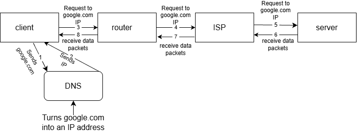

# Day 1: How the internet works

## Client and server

A **client** is the device that asks for something, like my laptop or phone running a browser. A **server** is a computer that stores a website or app and answers requests. When I open google.com, my laptop is the client and Google's computer is the server.

## What happens when I type a website name

1. My client asks a **DNS** server: "What is the IP address of google.com?"
2. DNS replies with the IP address. DNS works like the internet's address book, turning names into numbers.
3. My client sends a request to that IP address. It goes through my **router**, then my **ISP**, and across the internet to the server.
4. The server sends back the page data, split into small **packets**.
5. The packets travel back along the same path to my client, and my browser puts them together and shows the page.

## Diagram

